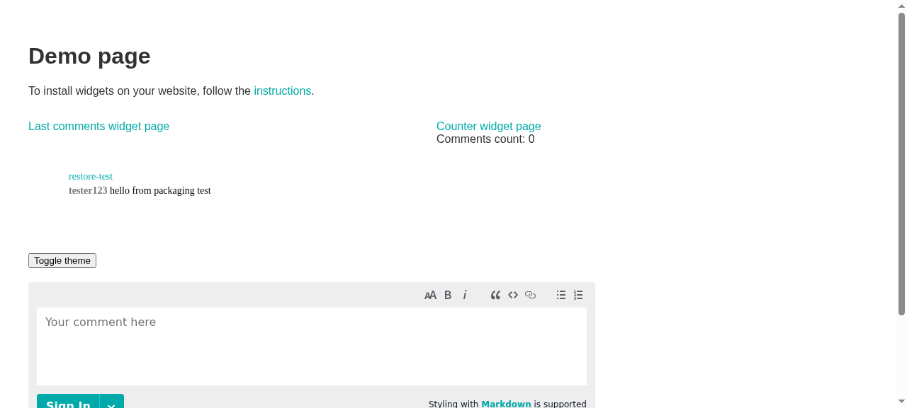

<!--
N.B.: This README was automatically generated by <https://github.com/YunoHost/apps_tools/blob/main/readme_generator>
It shall NOT be edited by hand.
-->

<h1>
  
  Remark42, packaged for YunoHost
</h1>

Self-hosted comment system to embed on any website

[](https://remark42.com)
[](https://remark42.com/demo/)


## Screenshots



## 📦 Developer info


🛠️ Upstream Remark42 repository: <https://github.com/umputun/remark42>


The `testing` branch can be tested using:
```
# fresh install:

# upgrade an existing install:
```

You can also switch to the testing branch to update from testing by default (as same as for APT when you chose to use a testing repos) with this command:
```bash
sudo yunohost app setting remark42 upgrade_channel -v testing
```

### 📚 App packaging documentation

Please see <https://doc.yunohost.org/dev/packaging/> for more information.
